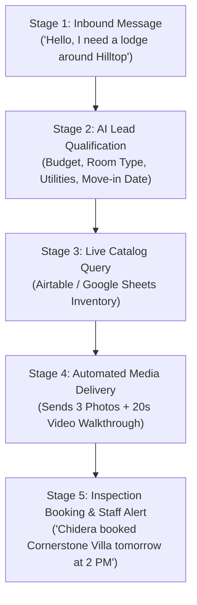

# KINGSOK ECOSYSTEM: AI WHATSAPP REAL ESTATE & STUDENT LODGE AUTOMATION BLUEPRINT
**Autonomous Lead Qualification, Dynamic Media Dispatch, Group Broadcasting, and Inspection Conversion Engine**  
*Target Market: University of Nigeria, Nsukka (UNN) 2026/2027 Academic Session*

---

## 1. Executive Summary & Strategic Vision

The annual influx of over **6,400+ newly admitted UNN undergraduate students** creates an immediate, concentrated demand for off-campus student accommodation across Nsukka (Hilltop, Odim Gate, Behind Flat, Green House, Ofulonu, etc.) and Enugu Campus.

Traditionally, student real estate agencies rely on manual WhatsApp messaging, leading to:
* **Severe response delays** (hours to reply while students message rival agents).
* **Manual photo/video searching** through thousands of gallery files.
* **Agent burnout and missed leads** during peak admission weeks.

### The Solution: "Big Brother KingSok" AI Concierge
An autonomous, 24/7 AI-powered WhatsApp system that instantly engages freshers, qualifies their budget and location preferences, pulls matching lodge videos and photos from a live inventory, and schedules in-person inspections directly into staff calendars.

---

## 2. The 5-Stage Customer Journey



### Detailed Breakdown:

1. **Stage 1: Inbound Lead Capture**
   * Students message the KingSok WhatsApp Business line from group invite links, flyers, or word-of-mouth.
   * AI greets them within **2 seconds** by name if available: *"Congratulations on your admission to UNN! 🎉 I'm KingSok's 24/7 Housing Concierge. Let's find your ideal room."*

2. **Stage 2: Interactive Qualification**
   * The AI asks 3 structured, friendly questions:
     1. *"What is your maximum annual budget (e.g., ₦180k, ₦250k, ₦400k)?"*
     2. *"Which area do you prefer (Hilltop, Odim Gate, Behind Flat, Green House, etc.)?"*
     3. *"Do you need specific amenities (Constant light/solar, borehole water, self-contain vs single room)?"*

3. **Stage 3: Database Matching**
   * The AI queries the **KingSok Live Lodge Inventory** and identifies the top 2 matching properties that fit the student's exact criteria.

4. **Stage 4: Media & Details Dispatch**
   * The AI automatically replies with:
     * High-resolution room and compound photos.
     * A compressed 15–20 second video walkthrough.
     * Distance to faculty (e.g., *“7 minutes walk to Engineering / Social Sciences”*).
     * Exact pricing, electricity, and water breakdown.

5. **Stage 5: Physical Inspection Handoff**
   * The AI asks: *"Would you like our KingSok field team to take you on a physical inspection tomorrow at 2:00 PM?"*
   * Once confirmed, it triggers an instant **Staff Alert** (via WhatsApp or SMS) to the KingSok field team with the student's name, phone, chosen lodge, and inspection time.

---

## 3. Automated Community & Daily Group Broadcasting

Beyond 1-on-1 chats, the engine manages KingSok’s community distribution:

* **Faculty & Department Communities**:
  * 1 WhatsApp Community per Faculty (e.g., *Faculty of Pharmaceutical Sciences*).
  * Sub-groups for each Department (e.g., *Pharmacy, Pharmacology*).
* **Automated Daily "Lodge of the Day" Daemon**:
  * Every morning at **8:30 AM**, the system selects an available property with vacant rooms.
  * Generates an engaging, emoji-rich student broadcast caption.
  * Automatically pushes the flyer and caption to all KingSok faculty groups simultaneously.
* **Anti-Ban Safety Protocols**:
  * Uses staggered delays (3–5 seconds between group posts).
  * Rotates message templates so WhatsApp spam filters never flag the account.

---

## 4. Technical Architecture & Tech Stack

| Layer | Recommended Tool | Purpose & Advantage |
| :--- | :--- | :--- |
| **WhatsApp Gateway** | **Evolution API / Baileys** | Open-source WhatsApp Web bridge. Connects to existing Nigerian phone numbers via QR code scan. Supports text, photos, video, voice notes, and groups. |
| **Workflow Engine** | **n8n (Self-Hosted)** | Visual workflow orchestrator. Handles incoming webhooks, routes messages, queries the database, and schedules daily group broadcasts. |
| **AI Intelligence** | **Gemini Flash / OpenAI** | High-speed, natural-language reasoning. Understands Nigerian student slang, campus abbreviations, and typos. |
| **Lodge Inventory** | **Airtable / Google Sheets** | Zero-code database where staff can add, edit, or mark rooms as 'Occupied' or 'Available'. |
| **Hosting & Infra** | **Cloud VPS / DigitalOcean** | \$6–\$12/month Linux server running 24/7 with 99.9% uptime. |

---

## 5. Staff Standard Operating Procedures (SOP)

### A. How Staff Manage the Inventory Sheet
Staff do not need technical skills. They simply update a Google Sheet or Airtable with columns:
1. `Lodge Name` (e.g., Cornerstone Villa)
2. `Location` (e.g., Hilltop)
3. `Room Type` (e.g., Self-Contain, Single Room)
4. `Annual Rent` (e.g., ₦250,000)
5. `Amenities` (e.g., Solar Inverter, Borehole, Fenced)
6. `Photos URL` (Google Drive / Cloudinary folder link)
7. `Video URL` (Direct MP4 video link)
8. `Status` (`Available` or `Occupied`)

> **Rule**: When a room is paid for, staff change Status to `Occupied`. The AI immediately stops offering it to new students.

### B. What Staff Do When an Alert Arrives
When a student confirms an inspection, staff receive an alert like:
```
🚨 NEW INSPECTION BOOKING - KINGSOK LODGES
• Candidate: Chidera Okonkwo
• Department: Medical Laboratory Sciences
• Phone: 0803XXXXXXX
• Target Lodge: Cornerstone Villa (Hilltop) - ₦240k
• Inspection Time: Tomorrow, 2:30 PM
• Assigned Guide: Agent Emeka
```
Staff only need to call the student 1 hour prior to confirm arrival at the designated meeting point (e.g., Peace Mass Park or Odim Gate).

---

## 6. Phased Rollout Roadmap

1. **Phase 1: Student Contact Foundation (Current)**
   * Complete 100% extraction of all 6,488 UNN admitted candidates with verified phone numbers.
   * Generate departmental `.vcf` contact files for community contact gain.
2. **Phase 2: Inventory Cataloging (Week 1)**
   * Film 15–20 second video tours of KingSok's premier lodges.
   * Populate the Master Lodge Google Sheet with photos, pricing, and amenities.
3. **Phase 3: Bot Deployment & Testing (Week 2)**
   * Deploy Evolution API and connect the KingSok WhatsApp line.
   * Configure n8n qualification flow and test with internal staff numbers.
4. **Phase 4: Full Multi-Group Launch (Admission Clearance Week)**
   * Activate daily group broadcasting.
   * Begin autonomous 24/7 lead handling and physical inspection bookings.

---
*Document prepared for KingSok Ecosystem Management & Operational Staff.*
